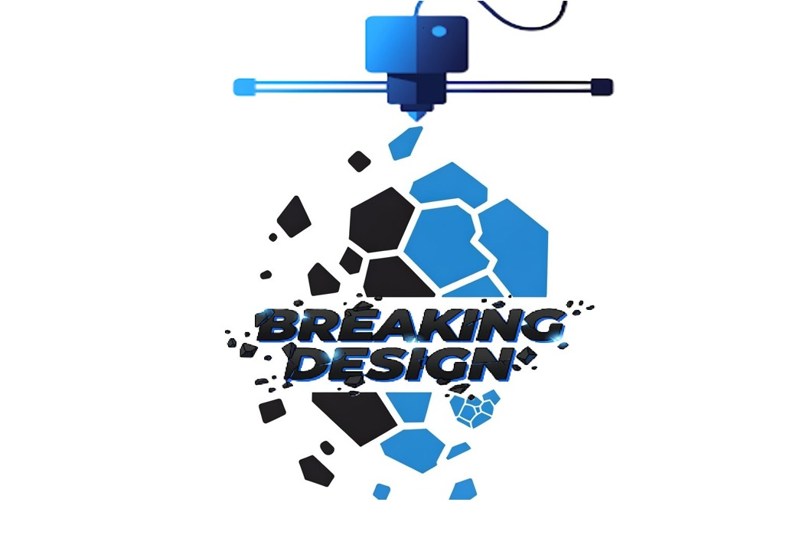

# BreakingDesingStock

<p align="center">
  
</p>

<h3 align="center">Sistema de gestión de stock y ventas para impresión 3D</h3>

<p align="center">
  <a href="http://breakingdesing.runasp.net/">
    
  </a>
</p>

---

## Descripción

**BreakingDesingStock** es una aplicación web desarrollada para Breaking Desing, un emprendimiento dedicado a la fabricación y comercialización de productos mediante impresión 3D.

El objetivo del proyecto es facilitar la administración del emprendimiento mediante un sistema que permite gestionar productos, controlar el inventario de materiales, registrar ventas y realizar un seguimiento del stock disponible.

La aplicación fue desarrollada como una herramienta de gestión personal, con acceso desde distintos dispositivos a través de internet.

## Funcionalidades principales

| Módulo | Descripción |
|---|---|
| Productos | Administración de productos, categorías, precios y existencias. |
| Filamentos | Gestión de materiales, colores y precios por kilogramo. |
| Inventario | Control de stock actual y configuración de stock mínimo. |
| Materiales por producto | Asociación de filamentos y registro de gramos utilizados y desperdiciados. |
| Ventas | Registro de ventas, cantidades, fechas y precios unitarios. |
| Costos | Registro de costos de impresión y costos adicionales de los productos. |

## Tecnologías utilizadas

| Tecnología | Implementación |
|---|---|
| C# | Lenguaje principal de desarrollo |
| ASP.NET Core 8 | Framework de desarrollo web |
| Razor Components / Blazor | Interfaz web interactiva |
| ADO.NET | Acceso a datos mediante SQL Server |
| Dapper | Micro ORM para ejecutar consultas SQL |
| SQL Server | Motor de base de datos relacional |
| HTML5 / CSS3 | Estructura y estilos de la interfaz |

## Estructura de la base de datos

El sistema utiliza SQL Server para almacenar la información del emprendimiento.

Las principales tablas son:

- **Filamentos:** información de los materiales disponibles.
- **Productos:** catálogo de productos, precios y stock.
- **ProductoFilamentos:** relación entre productos y los filamentos utilizados en su fabricación.
- **Ventas:** historial de operaciones comerciales.

## Demo online

La aplicación se encuentra publicada y puede visitarse desde el siguiente enlace:

**[Abrir BreakingDesingStock](http://breakingdesing.runasp.net/)**

La versión online tiene fines demostrativos y corresponde a una herramienta de gestión interna del emprendimiento.

## Instalación y ejecución local

### Requisitos

- .NET 8 SDK
- SQL Server
- Visual Studio 2022 o un entorno compatible con .NET 8

### Pasos

1. Clonar el repositorio:

   ```bash
   git clone https://github.com/Neflim/BreakingDesingStock.git
   ```

2. Abrir la solución del proyecto en Visual Studio.

3. Crear la base de datos en SQL Server utilizando el script SQL correspondiente.

4. Configurar la cadena de conexión en `appsettings.json`:

   ```json
   {
     "ConnectionStrings": {
       "Default": "Server=TU_SERVIDOR;Database=StockImpresiones3D;Trusted_Connection=True;TrustServerCertificate=True;"
     }
   }
   ```

5. Restaurar las dependencias:

   ```bash
   dotnet restore
   ```

6. Ejecutar la aplicación:

   ```bash
   dotnet run
   ```

> Reemplazar los datos de conexión por los correspondientes al entorno local. No publicar contraseñas ni credenciales reales en el repositorio.

## Objetivo del proyecto

BreakingDesingStock fue desarrollado para resolver necesidades reales de administración de un emprendimiento de impresión 3D.

Este proyecto permitió aplicar conocimientos de programación en C#, desarrollo web con ASP.NET Core, acceso a datos con ADO.NET, consultas SQL y diseño de bases de datos relacionales.

También representa una experiencia práctica de desarrollo de software orientada a resolver un problema concreto de un negocio.

---

<p align="center">
  Desarrollado con C# y ASP.NET Core 8
  <br>
  <strong>Breaking Desing</strong>
</p>
